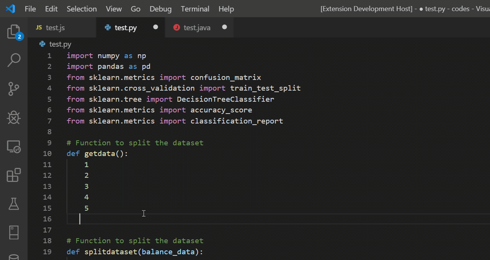

# List2Array

List2Array is a VS Code extension that simplifies converting line-break-separated lists into arrays for various programming languages.

### Data Types Supported
- Integer
- String
- Floating-point numbers

## Features

Select the raw list you want to convert, run the "List to Array" command, and get your array instantly!

- **Select** your list.
- **Launch** the command.
- **Get** your formatted array!

## Supported Languages
- JavaScript / TypeScript
- Python
- Java
- C#
- C++

## Configuration

You can customize the output by changing the following settings in your VS Code `settings.json`:

- `list2array.includeVariableName` (boolean, default: `true`): Toggles whether to include the variable declaration (e.g., `var arr = `).
- `list2array.variableName` (string, default: `"arr"`): Sets a custom name for the output array variable.

> Tip: You can assign a keyboard shortcut to the "List to Array" command from VS Code's keyboard shortcuts settings for even faster use.

## Release Notes

### 1.1.0

- Added support for C#, C++, and TypeScript.
- Added user settings to control variable name inclusion and customization.
- Refactored codebase for better extensibility.

### 1.0.0

Initial release of List2Array

### For more information

* [GitHub Project](https://github.com/AkashChikane/List2Array)

**Enjoy!**